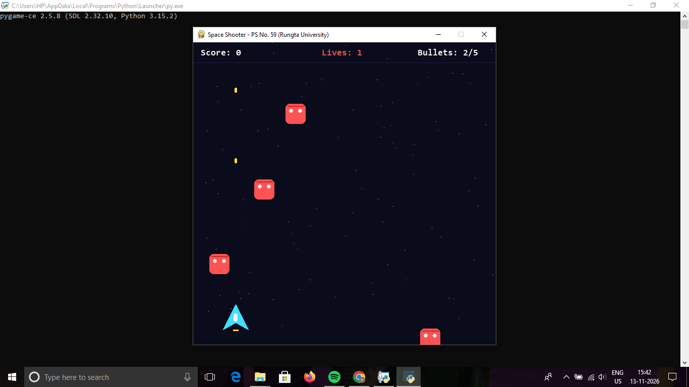
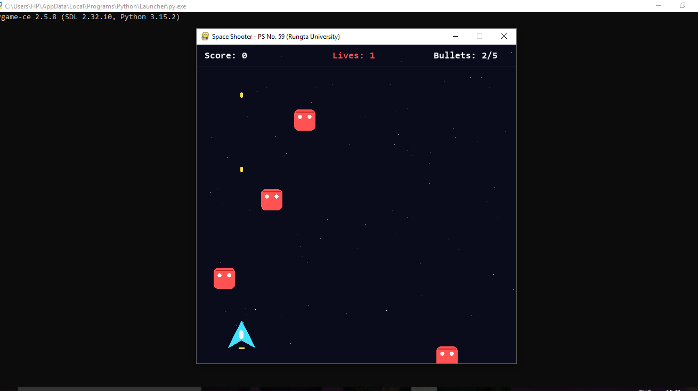
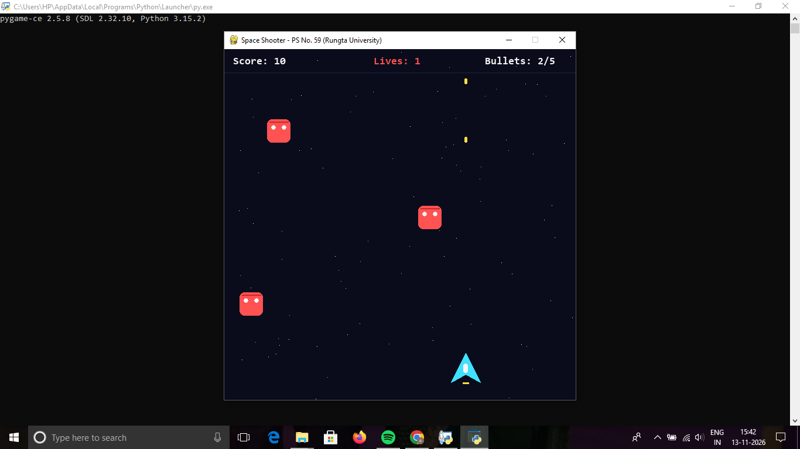
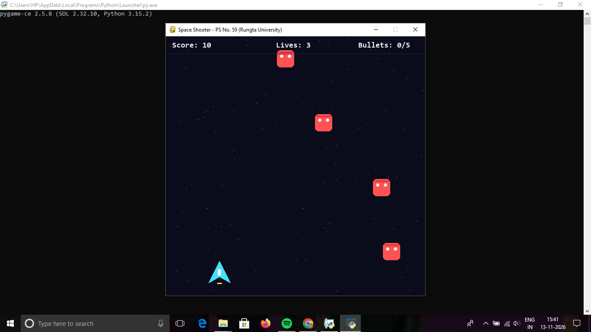
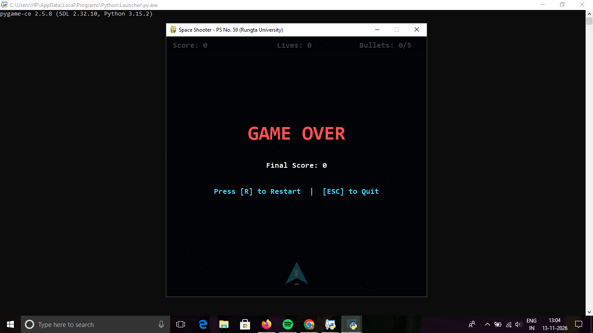

# Space Shooter (Problem Statement No. 59)

## Academic Submission Details

| Field | Description |
| :--- | :--- |
| **Course Name** | Programming Fundamentals and Logic Building Using Python |
| **Course Code** | RU-100-01-0021 |
| **Institution** | Rungta International Skills University (RISU) |
| **Department** | School of Computer Science and Engineering |
| **Degree** | Bachelor of Technology (Computer Science & Engineering) |
| **Academic Session** | 2026–2027 |
| **Semester & Section** | First Semester / Section K |
| **Student Name** | Anushka Keshri |
| **University Roll Number** | RU-26-01601 |
| **Problem Statement Number** | PS No. 59 |
| **Date of Allocation** | 14th October 2026 |
| **Date of Submission** | 16th November 2026 |

---

## 1. Problem Statement Definition

Build a 2D arcade space shooter game in Python 3 using Pygame in which the player's spaceship moves left and right at the bottom of the screen and fires bullets upward to destroy enemy ships descending from the top. The player earns points for each hit and loses a life when an enemy reaches the bottom of the window.

### Technical Specifications
- **Window Dimensions:** 600 px (width) by 600 px (height).
- **Player Spaceship:** 50 px wide by 50 px high, locked at vertical coordinate $y = 520$, starts horizontally at $x = 275$. Moves horizontally by 8 px per keystroke. Clamped within window boundaries ($0 \le x \le 550$).
- **Bullet:** 5 px wide by 10 px high. Emerges from the horizontal center-top of the ship ($x = \text{ship}.x + 25$, $y = 520$). Moves upward at 10 px per frame. A maximum of 5 bullets can exist simultaneously on screen.
- **Enemy Craft:** 40 px wide by 40 px high. Descends from the top ($y = 0$) at 2 px per frame.
- **Scoring System:** Each successful bullet-enemy hit awards $+10$ points and removes both the colliding bullet and enemy.
- **Life Tracking:** The player begins with 3 lives. If an enemy reaches or crosses the bottom edge ($y \ge 600$), the player loses 1 life. When lives reach 0, the game enters a Game Over state displaying the final score and options to restart or exit.

---

## 2. Bare Minimum Requirements (BMR) Compliance

| # | Bare Minimum Requirement | Implementation in `main.py` | Status |
| :-: | :--- | :--- | :-: |
| 1 | Write the solution in Python 3 (one `.py` file) using Pygame and run it from the console | Single self-contained script `main.py` (also callable as `One.py`) executed directly via `python main.py` or `python One.py`. | Satisfied |
| 2 | Create Ship, Bullet and Enemy as classes (objects) with position, size and speed | Structured OOP architecture implementing `Ship`, `Bullet`, and `Enemy` classes with explicit $(x, y)$, dimensions $(w, h)$, velocities, and bounding boxes. | Satisfied |
| 3 | Move the ship with LEFT/RIGHT arrows, fire bullets with SPACE and limit the bullets on screen to 5 | `Ship.move()` handles arrow key input with $[0, 550]$ screen clamping. `SpaceShooter.fire_bullet()` strictly rejects fire requests when active bullets equal 5. | Satisfied |
| 4 | Detect bullet-enemy collisions using `Rect.colliderect()`; add 10 to the score for every enemy destroyed | `SpaceShooter.check_collisions()` queries `bullet.rect.colliderect(enemy.rect)`, destroys both entities on impact, and adds $+10$ points to score. | Satisfied |
| 5 | Reduce a life when an enemy reaches the bottom; show 'Game Over' with the final score when lives reach 0 | `update_enemies()` removes enemies at $y \ge 600$, decrements lives, and transitions to modal Game Over overlay with final score and restart key `[R]`. | Satisfied |

---

## 3. Mathematical & Algorithmic Formulations

### 3.1 Spaceship Boundary Clamping
The spaceship width $W_s = 50\text{ px}$ must never cross the screen bounds $W = 600\text{ px}$. For any horizontal shift $\Delta x \in \{-8, +8\}$:
$$x_{t+1} = \max\Big(0,\, \min\big(x_t + \Delta x,\, 600 - W_s\big)\Big) = \max\Big(0,\, \min\big(x_t + \Delta x,\, 550\big)\Big)$$

### 3.2 Centered Bullet Emission
Bullets fire from the top-center vertex of the spaceship. Given ship coordinate $(x_s, y_s)$ and width $W_s = 50$:
$$x_{\text{bullet\_center}} = x_s + \frac{W_s}{2} = x_s + 25$$
$$y_{\text{bullet\_top}} = y_s = 520$$
With bullet dimensions $W_b = 5$, $H_b = 10$, the top-left bounding box rectangle is:
$$\text{Rect}_b = \left(x_s + 25 - \left\lfloor\frac{W_b}{2}\right\rfloor,\, 520,\, 5,\, 10\right) = (x_s + 23,\, 520,\, 5,\, 10)$$

### 3.3 Axis-Aligned Bounding Box (AABB) Collision Condition
Let bullet bounding box $R_1 = (x_1, y_1, w_1, h_1)$ and enemy bounding box $R_2 = (x_2, y_2, w_2, h_2)$. Collision exists if and only if their 1D projection intervals overlap on both Cartesian axes:
$$\text{colliderect}(R_1, R_2) \iff (x_1 < x_2 + w_2) \land (x_1 + w_1 > x_2) \land (y_1 < y_2 + h_2) \land (y_1 + h_1 > y_2)$$

---

## 4. Acceptance Test Cases Verification Record

| Test Case | Scenario / Preconditions | Input Trigger | Expected Output | Observed Output | Result |
| :--- | :--- | :--- | :--- | :--- | :---: |
| **Test Case 1** | Normal Input: Ship at $x = 275$, 0 bullets on screen | Press `SPACE` | Bullet fired at $(300, 520)$<br>Bullets on screen: 1 | `Bullet fired at (300, 520) \| Bullets on screen: 1` | PASS |
| **Test Case 2 (a)** | Boundary Min: Ship at $x = 0$ (left window edge) | Press `LEFT` arrow | Ship $x = 0$ (no movement, stays inside window) | `Ship x = 0 (no movement, stays inside window)` | PASS |
| **Test Case 2 (b)** | Boundary Max: Ship at $x = 550$ (right window edge) | Press `RIGHT` arrow | Ship $x = 550$ (no movement, stays inside window) | `Ship x = 550 (no movement, stays inside window)` | PASS |
| **Test Case 3** | Invalid Input: 5 bullets already active on screen | Press `SPACE` | Maximum 5 bullets on screen. No bullet fired.<br>Bullets on screen: 5 | `Maximum 5 bullets on screen. No bullet fired.`<br>`Bullets on screen: 5` | PASS |
| **Test Case 4 (a)** | Collision Event: Bullet at $(300, 100)$, Enemy at $(280, 90)$ | Frame update | Enemy destroyed<br>Score: 10 \| Lives: 3 | `Enemy destroyed \| Score: 10 \| Lives: 3` | PASS |
| **Test Case 4 (b)** | Escaped Enemy: Enemy reaches $y = 600$, starting lives: 3 | Frame update | Enemy escaped<br>Lives: 2 | `Enemy escaped \| Lives: 2` | PASS |

---

## 5. Controls & User Interface Layout

| Command | Key Binding | Action Description |
| :--- | :--- | :--- |
| **Navigate Left** | `LEFT Arrow` or `A` | Translates the spaceship left by 8 px (bounded at $x = 0$) |
| **Navigate Right** | `RIGHT Arrow` or `D` | Translates the spaceship right by 8 px (bounded at $x = 550$) |
| **Discharge Laser** | `SPACEBAR` | Spawns an upward bullet if current active bullets $< 5$ |
| **Restart Session** | `R` | Resets game state, score, lives, and entities after Game Over |
| **Exit Application** | `ESCAPE` or Close Window | Terminates the Pygame process and closes window |

---

## 6. How to Run the Project

### Prerequisites
- Python 3.10, 3.11, or 3.12 installed.
- Pygame library installed (`pip install pygame`).

### Running the Game
To launch the interactive 60 FPS graphical game:
```powershell
python main.py
```
*(Alternatively: `python One.py`)*

---

## 7. Visual Verification & Gameplay Evidence

### 7.1 Application Launch & Game Setup
Execution of the game launching the 60 FPS Pygame window:



### 7.2 Active Gameplay & HUD
Real-time gameplay showing player spaceship, descending enemies, laser emission, and HUD (Score, Lives, Bullet capacity):



### 7.3 Bullet-Enemy Collision Detection
Visual proof of bullet impact destroying enemy targets and incrementing score:



### 7.4 Scoring & Life Deduction System
Real-time score accumulation and life decrement when an enemy evades interception:



### 7.5 Modal Game Over Screen
Final score presentation upon depletion of all 3 player lives with restart option:



---

## 8. Academic Integrity & Verification
This project is an authentic, independent implementation of Problem Statement No. 59 developed for university academic evaluation under course code RU-100-01-0021.
